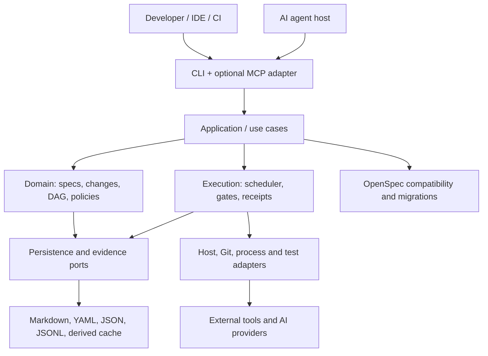

# PentaPRO Engine
## Especificação de visão, requisitos e arquitetura para exploração de desenvolvimento

**Data:** 25 de novembro de 2026
**Versão:** 0.1 — proposta de entrada para discovery, não baseline aprovada
**Produto:** PentaPRO Engine (nome de trabalho)
**Tecnologia mandatória do núcleo:** Rust
**Destinatários:** mantenedor do PentaPRO, agente principal de exploração e agentes da fábrica de software
**Escopo pretendido:** paridade funcional integral com OpenSpec e automação nativa do PentaPRO, para SDD e vibe coding.

> Este documento é uma entrada para a exploração com a skill `pentapro` (denominada `penta-pro` no snapshot que foi possível consultar). Não constitui autorização de implementação, publicação ou mudança do PentaPRO existente. As decisões propostas devem ser confrontadas com os contratos atuais e com o plano de manutenção antes de serem aceitas. Os artefatos canônicos a produzir pela skill devem ser escritos em inglês, conforme a política vigente, embora este relatório de entrada esteja em português.

## Sumário

1. [Base de evidências e condições de início](#1-base-de-evidências-e-condições-de-início)
2. [PRODUCT — visão, usuários e escopo](#2-product--visão-usuários-e-escopo)
3. [PRODUCT — recuperação e paridade OpenSpec](#3-product--recuperação-e-paridade-openspec)
4. [PRODUCT — requisitos adicionais PentaPRO](#4-product--requisitos-adicionais-pentapro)
5. [PROJECT — arquitetura e contratos](#5-project--arquitetura-e-contratos)
6. [PROCESS — workflows, agentes e autoridade](#6-process--workflows-agentes-e-autoridade)
7. [PROJECT — interface e experiência](#7-project--interface-e-experiência)
8. [PRODUCTION — portabilidade, distribuição e operação](#8-production--portabilidade-distribuição-e-operação)
9. [PROOF — qualidade, performance e verificação](#9-proof--qualidade-performance-e-verificação)
10. [PROCESS — roadmap e estratégia de desenvolvimento](#10-process--roadmap-e-estratégia-de-desenvolvimento)
11. [Riscos, decisões abertas e critérios de início](#11-riscos-decisões-abertas-e-critérios-de-início)
12. [Instruções para a exploração e referências](#12-instruções-para-a-exploração-e-referências)

---

## 1. Base de evidências e condições de início

### 1.1. Mandato do mantenedor — confirmado pelo pedido

- Construir o PentaPRO Engine em Rust, com máxima qualidade, completude funcional e performance mensurada.
- Recuperar a arquitetura, as especificações e todas as funcionalidades do OpenSpec; entregá-las na nova solução, sem depender do runtime Node.js para o funcionamento do núcleo.
- Adaptar e ampliar o produto para o fluxo de processos dos agentes da fábrica PentaPRO, incluindo desenvolvimento informal (vibe coding) e Spec-Driven Development (SDD).
- Considerar a nova organização do repositório `teknolista/pentapro` e todas as propostas de manutenção de 25/11/2026.
- Usar este relatório como entrada de exploração, não substituir a descoberta, especificação, revisão e autorização próprias do PentaPRO.

### 1.2. Fontes verificadas e limitação material

| Fonte | Revisão consultada | O que estabelece |
|---|---|---|
| [PentaPRO](https://github.com/teknolista/pentapro/tree/b6a9a96137a7ee996d16bf6eefe7a22648c82703) | `b6a9a96137a7ee996d16bf6eefe7a22648c82703`, main, 24/11/2026 | Repositório renomeado acessível; documentação ainda menciona o antigo nome `teknolista/skills`; skill `penta-pro` 4.0.2, 24 skills, seis perfis de fábrica e contratos nativos de SDD e persistência. |
| [Plano de melhorias solicitado](https://github.com/teknolista/pentapro/blob/main/docs/pentapro-improvement-plan-2026-11-25.md) | **Não acessível** | A leitura retornou 404. A árvore do commit e a única branch listada (`main`) não continham o caminho. A tentativa pelo antigo repositório e a busca por nome na biblioteca não localizaram uma cópia. |
| [OpenSpec](https://github.com/Fission-AI/OpenSpec/tree/f1cd852f4edce22b8df9548a4df889172ca8ff25) | `f1cd852f4edce22b8df9548a4df889172ca8ff25`, versão 2.2.0 declarada no `package.json` consultado | TypeScript, Node.js >=22.20.0; CLI, schemas, stores, context, worksets, workflows, adaptadores e contratos JSON. A versão deverá ser confirmada com checkout e tag antes de congelar a referência. |

**Impedimento de completude:** não é possível afirmar que as propostas do arquivo de 25/11 estejam incorporadas. O relatório utiliza os contratos efetivamente acessíveis, as exigências do mantenedor e recomendações explícitas. Não se infere o conteúdo do plano nem se assume que alterações locais tenham sido publicadas. A recuperação da totalidade dos requisitos do OpenSpec também ainda não foi executada: esta é uma especificação de escopo e estratégia, com inventário inicial verificável.

### 1.3. Descoberta obrigatória e reconciliação do plano (gate G0)

Antes de aprovar uma arquitetura definitiva ou escrever código de produto:

1. Inspecionar o checkout efetivo de `teknolista/pentapro`, inclusive alterações locais autorizadas, branch, revisão, `AGENTS.md`, árvore de skills, contratos, testes e plano `docs/pentapro-improvement-plan-2026-11-25.md`. Registrar hash do arquivo quando não estiver commitado. Identificar o nome e caminho efetivos da skill após a reorganização.
2. Inventariar **cada** proposta do plano, com identificador estável `IMP-nnn`, referência à seção original, problema, decisão/estado, pré-requisitos, donos, requisitos impactados, migração, critérios de aceite e evidências necessárias. Não reduzir a cobertura às propostas julgadas convenientes.
3. Classificar cada proposta como `Engine`, `Skill`, `Shared contract`, `Adapter`, `Documentation`, `Evaluation` ou `Not applicable` (com justificativa); separar decisões aprovadas de sugestões ainda abertas. Resolver colisões com o contrato vigente e com a paridade OpenSpec. Não converter proposta em requisito confirmado automaticamente.
4. Produzir matriz bidirecional `IMP → requisito → componente → teste → release` e registrar divergências. Exigir zero itens sem disposição. O responsável aprova os conflitos materiais, não cada detalhe técnico trivial.
5. Fixar o commit/tag de OpenSpec, recuperar licenças, testes e a superfície funcional completa. Repetir o levantamento caso a baseline escolhida difira da referência deste relatório.

Formato sugerido para a reconciliação:

| ID | Fonte / trecho | Estado | Destino | Requisito Engine | Contrato / migração | Aceite / evidência |
|---|---|---|---|---|---|---|
| IMP-001 | A preencher a partir do arquivo real | Pending | A definir | A definir | A definir | A definir |

A ausência do plano bloqueia a aprovação do escopo completo, não impede a exploração de alternativas e a análise inicial. Nenhuma linha dessa matriz representa proposta efetivamente extraída do arquivo ausente.

### 1.4. O que já existe no PentaPRO — não reinventar

Os contratos consultados ([native SDD](https://github.com/teknolista/pentapro/blob/b6a9a96137a7ee996d16bf6eefe7a22648c82703/docs/native-sdd-contract.md), [software-factory](https://github.com/teknolista/pentapro/blob/b6a9a96137a7ee996d16bf6eefe7a22648c82703/software-factory/SKILL.md), [persistência](https://github.com/teknolista/pentapro/blob/b6a9a96137a7ee996d16bf6eefe7a22648c82703/software-factory/references/run-records.md), [eventos](https://github.com/teknolista/pentapro/blob/b6a9a96137a7ee996d16bf6eefe7a22648c82703/software-factory/references/invocation-events.md)) já definem:

- Cinco dimensões canônicas, mudanças nativas, seis documentos por mudança, revisão, aprovação, consolidação e archive; execução sem dependência externa do OpenSpec.
- O agente principal como orquestrador, com seis papéis especialistas e autoridade limitada, seleção de modelo/esforço configurada pelo projeto e revisão independente.
- Persistência opcional de execução, fingerprints, invalidação de gates, controle de versão, bloqueio de escritor e reconciliação de efeitos incertos; invocações com eventos append-only.
- PDSA por papel, correção limitada a duas tentativas para a mesma falha, registro de lições em inglês, retroalimentação separada da autorização de modificar skills.
- Setup idempotente, preservação de customizações, política de prompt logging, instalação/empacotamento de skills por host, critérios de validação e evidências de uso.

O Engine deverá **executar e fortalecer esses contratos**, não introduzir um segundo processo concorrente. O contrato atual explicitamente dispensa um CLI SDD e schema configurável; o novo Engine é uma evolução deliberada, e não uma dependência que se possa impor retroativamente. Recomenda-se manter o modo baseado apenas nas skills funcional durante adoção e migração.

## 2. PRODUCT — visão, usuários e escopo

### 2.1. Visão

Criar um motor local, portátil e determinístico de engenharia de software assistida por IA. O produto converte procedimentos repetitivos em software convencional, deixa decisões semânticas e criativas aos agentes, torna verificável o progresso da fábrica e reduz o custo de inferência, sem sacrificar qualidade ou autonomia humana.

**Proposta de valor:** uma solicitação de desenvolvimento pode seguir um processo reproduzível e auditável, com estado durável, especificações e mudanças gerenciadas, tarefas, revisão independente, evidências e entrega controlada. O desenvolvedor pode escolher qualquer host de IA compatível ou trabalhar sem IA nas funções determinísticas.

### 2.2. Personas e jobs-to-be-done

| Persona | Necessidade | Resultado esperado |
|---|---|---|
| Desenvolvedor solo / indie | Automatizar trabalho e gastar menos créditos | Um ponto de entrada, execução proporcional e retomada sem reexplicar o projeto |
| Engenheiro de software | Preservar contratos e qualidade | Requisitos rastreáveis, TDD quando aplicável, revisão e gates confiáveis |
| Líder técnico / mantenedor | Governar múltiplos agentes, projetos e modelos | Políticas versionadas, autorização e observabilidade, sem lock-in |
| Agente de programação | Obter a próxima tarefa e contexto mínimo | Instruções estruturadas, caminhos resolvidos, orçamento e contratos claros |
| Revisor / auditor | Reconstruir o que ocorreu | Evidências vinculadas ao snapshot, independência declarada e lacunas explícitas |
| Usuário OpenSpec | Migrar ou usar ferramenta equivalente | Preservação de specs, schemas, histórico, integrações e comportamento |
| Equipe / CI | Verificar alterações sem sessão interativa | CLI estável, JSON, códigos de saída e execução reprodutível |

### 2.3. Princípios de produto

1. **Deterministic where possible, cognitive where necessary.** Não pedir a um LLM para comparar hashes, ordenar dependências, verificar existência de arquivos ou repetir verificações que código convencional resolve.
2. **Qualidade como restrição, performance como objetivo mensurável.** Não acelerar pulando validações, revisões, aprovações ou salvaguardas obrigatórias.
3. **Single source of truth.** Uma fonte canônica de cada decisão, uma identidade por mudança/run, uma política efetiva e um proprietário de escrita por operação.
4. **Local-first e offline-first.** Funções de arquivo, estado, planejamento e validação operam sem conta ou rede. Rede é necessária somente para operações que a exigem, como inferência remota, obtenção de pacote ou push.
5. **Host-agnostic.** O Engine não depende de modelo ou provedor específico. A integração opcional preserva os controles reais de cada host.
6. **Proportionality.** Vibe coding não deve exigir burocracia de SDD completo; mudanças críticas não devem contornar gates pela escolha de perfil econômico.
7. **Evidence over claims.** Documento completo, retorno de agente, arquivo presente e status de teste são evidências distintas; nenhum substitui aprovação humana.
8. **Progressive disclosure.** Contexto compacto, referências sob demanda e nenhum agente supervisor desnecessário.
9. **Recoverability by design.** Interrupções, queda de energia, limite de créditos e falha de rede são cenários de produto, não exceções ignoradas.
10. **Open interfaces.** Contratos versionados, Markdown legível e API CLI/JSON estável. Proposta de licença MIT sujeita à confirmação do mantenedor; avisos de terceiros obrigatórios.

### 2.4. Escopo e não objetivos

**Dentro do escopo da versão 1.0:** paridade de funcionalidades OpenSpec na baseline congelada (inclusive stores, worksets, schemas e integrações de instruções), compatibilidade verificável, fluxo PentaPRO nativo, vibe coding, SDD, perfis de custo, integração com hosts, registros e métricas, auditoria, migração, distribuição nativa e documentação.

**Fora do núcleo:** criação de um novo LLM, IDE geral, provedor de inferência, infraestrutura SaaS obrigatória, substituição de Git, compiladores e ferramentas de testes, garantia de correção semântica automática, aprovação de resultado em nome do usuário. GUI desktop, servidor MCP e integração softheca são extensões propostas, não pré-condições da paridade CLI; a interface interativa de terminal equivalente ao OpenSpec integra o escopo 1.0.

## 3. PRODUCT — recuperação e paridade OpenSpec

### 3.1. Estratégia de engenharia reversa legítima

O OpenSpec declara licença MIT. Usar código, documentação e testes como fontes de recuperação de especificação é possível preservando avisos e condições da licença; conferir a licença efetiva de cada artefato incorporado e dependência. Não se exige clean room estrito; separar, contudo, requisitos observáveis de implementação em TypeScript para não transportar acidentalmente restrições do runtime. Registrar a proveniência de todo material reutilizado e não sugerir afiliação oficial.

Executar três fases: **reverse engineering → specification recovery → forward engineering**. A primeira inspeciona código e testes, a segunda descreve comportamento independente de tecnologia, a terceira implementa em Rust com TDD e testes diferenciais. A organização interna do OpenSpec não é a arquitetura obrigatória da nova ferramenta.

### 3.2. Inventário inicial de requisitos de paridade

Todos os grupos abaixo são mandatórios para a alegação de paridade. Os IDs `OS-*` identificam famílias, a serem decompostas em requisitos atômicos durante discovery. Os comandos citados são a superfície OpenSpec observada/documentada; o Engine poderá fornecer comandos equivalentes nativos e uma fachada compatível.

| ID | Família / superfície OpenSpec | Comportamento a recuperar, implementar e provar |
|---|---|---|
| OS-01 | `init`, `update` | Inicialização local, seleção de ferramentas, idioma, perfis, geração de skills/comandos, atualização, limpeza/migração legada, dry-run/JSON, preservação de customizações e tratamento de falhas parciais. |
| OS-02 | `list`, `show`, `view`; comandos legados spec/change | Listagem de mudanças e specs, detalhes, seleção de tipo quando ambíguo, progresso de tasks, visualização interativa e compatibilidade de aliases/flags constatados no código. |
| OS-03 | Parser de specs e changes | Markdown, headings de requisitos e cenários, requisitos normativos, tarefas, frontmatter/configuração, identidade, conteúdo não reconhecido e diagnósticos com localização. |
| OS-04 | `validate` | Validação individual, bulk/all/specs/changes, strict, paralelismo, saída JSON, arquivo histórico e tasks pendentes, regras condicionais e ausência de efeitos de escrita. |
| OS-05 | Deltas e consolidação | ADDED, MODIFIED, REMOVED, RENAMED, preservação de cenários e conteúdo não afetado, conflitos, mudanças simultâneas, aposentadoria de capabilities, regras de skip e perda involuntária de requisitos. |
| OS-06 | `new change`, `archive` | Criação de mudança, metadados/schema, nomes, colisões, atualização da baseline, `--skip-specs`, `--no-validate` e seus limites, archive datado e preservação de conteúdo. |
| OS-07 | `status`, `instructions` | Grafo de artefatos, caminhos efetivos, ready/blocked/done/skipped, seleção de mudança/schema, batch status, next steps, contexto/regras/referências, superfícies apply/archive, estabilidade da ordenação. |
| OS-08 | `schemas`, `templates`, `schema init/fork/validate/which` | Schemas embutidos/customizados, precedência de resolução, templates, DAG, dependências, ciclos, referências, validação, duplicação e criação de workflows. |
| OS-09 | `config` | Configuração global e local, perfis core/custom, workflows selecionáveis, modo de entrega (skills/comandos/ambos), defaults, precedência, edição e compatibilidade histórica; caminhos de configuração por SO. |
| OS-10 | `store setup/register/unregister/remove/list/doctor` | Registro de stores independentes, criação, desregistro versus exclusão, referências entre projetos, default, origem Git, identidade, diagnóstico de relacionamento, seleção explícita de raiz e prevenção de escrita equivocada. |
| OS-11 | `doctor`, `context` | Saúde dos relacionamentos, configuração, resolução da raiz e contexto composto de stores referenciados sem copiar conteúdo integral; diagnósticos e dicas de correção. |
| OS-12 | `workset create/list/open/remove` | Conjuntos pessoais de projetos/stores, criação/remoção/lista, resolução de membros, abertura em editor ou terminal/host, persistência local, caminhos inválidos e seleção não interativa. |
| OS-13 | OPSX quick path e expanded | `propose`, `explore`, `new`, `continue`, `ff`, `apply`, `update`, `verify`, `sync`, `archive`, `bulk-archive`, `onboard`; skill/command templates, situações interativas, conclusão e erros. |
| OS-14 | Integrações e perfis de host | Todo o catálogo fixado em `AI_TOOLS`, aliases, convenções de arquivos e sintaxes, shared `.agents`, integrações legadas e opção Copilot cloud. Distinguir instalação estática de execução real do host. |
| OS-15 | CLI e API agêntica | Flags globais e por comando, help/version, códigos de saída, stdout/stderr, formas JSON, seleção root/store/schema, TTY/não interativo, ambiente, diagnostics e casos de falha. |
| OS-16 | Ferramentas auxiliares | Completion e instalação/desinstalação por shell, feedback explícito, detecção de versões/instalação, standalone e atualizações conforme modo de distribuição, sem efeitos inesperados. |
| OS-17 | Migração, manutenção e documentação | Migração de formatos/configurações/profiles, legado, documentação de uso e upgrade, compatibilidade de projetos existentes, recuperação segura e diagnósticos úteis. |
| OS-18 | Recursos descobertos no inventário integral | Qualquer comando oculto, alias, opção, arquivo, schema, comportamento ou integração material não enumerado nesta matriz deverá ter ID, teste e decisão. Não é permitido usar esta linha genérica como substituto de inventário completo. |

**Ponto particularmente importante:** a CLI do OpenSpec não executa sozinha todas as etapas cognitivas de OPSX. Parte dessas funcionalidades consiste em instruções geradas para um agente. Paridade exige preservar o fluxo utilizável, não inventar uma dependência de inferência para comandos puramente determinísticos.

### 3.3. Contrato de compatibilidade

Proposta: disponibilizar modo nativo PentaPRO e modo OpenSpec, ambos sobre bibliotecas Rust comuns. O modo OpenSpec deve ler/escrever a árvore `openspec/` e conservar formatos, comportamento externo, JSON (incluindo diferenças históricas de casing, omissão de campos versus null), códigos de saída, opções e precedência. Um eventual binário/alias `openspec` compatível será opt-in, identificado como implementação independente; não sobrescrever instalação upstream. O modo nativo usa `pentapro/`, não exige conversão para OpenSpec e não importa regras de autorização mais permissivas de outro modo.

As regras de compatibilidade e segurança podem entrar em conflito: comportamentos perigosos ou bugs upstream precisam de registro formal, teste de regressão, decisão do mantenedor, mensagem de migração e exceção documentada. Não declarar paridade exata em um comportamento intencionalmente divergente. O produto final deve oferecer a funcionalidade equivalente de modo seguro.

A precedência de raiz em OpenSpec documentada na referência de agentes deve ser testada: `--store` explícito; raiz ancestral local real ou ponteiro declarado; default global; ausência/erro com stores registrados; fallback implícito permitido apenas nas superfícies upstream que o adotam. Uma referência externa é contexto read-only, não autoridade para escrita. Em modo PentaPRO, nenhuma seleção implícita pode trocar o repositório autorizado silenciosamente.

### 3.4. Matriz e método de prova de paridade

Criar um catálogo de todos os comandos, subcomandos, opções, aliases, defaults, variáveis, arquivos gerados e regras, correlacionando `src/`, testes, documentação, esquemas e comportamento do binário. Executar a referência TypeScript **somente no ambiente de desenvolvimento/QA**, não como dependência do Engine distribuído. Registrar `upstream_commit`, ID de requisito, localização, fixture, invocação, código de saída, stdout/stderr, estado do filesystem antes/depois, diferença normalizada, resultado e justificativa.

| ID de exemplo | Contrato | Caso diferencial mínimo |
|---|---|---|
| OS-05.01 | Delta MODIFIED preserva cenários não alterados segundo contrato upstream | Spec com múltiplos cenários; alteração incompleta; verificar rejeição ou comportamento exato; confirmar ausência de escrita indevida |
| OS-07.01 | Ordenação de artefatos | DAG com dependências simultaneamente prontas; ordem declarada e desempate conforme upstream |
| OS-10.01 | Seleção de raiz | Duas raízes, store explícito, referência ausente, default inválido e link que escapa do destino |
| OS-01.01 | Atualização dry-run | Comparar manifesto previsto e efeitos reais; dry-run não escreve nem modifica configuração |
| OS-15.01 | Contrato JSON | Uma resposta JSON válida no stdout, sem spinner, erros e código de saída conforme comando |

Normalizar somente campos realmente não determinísticos (timestamps, paths temporários, duração), conservando diferenças semânticas e ordenações relevantes. Cobrir Windows e POSIX; usar fixtures e versões pinadas. **Gate de release:** 100% das entradas inventariadas com disposição, nenhuma funcionalidade exigida ausente, todos os casos obrigatórios aprovados ou exceções explícitas aceitas sem mascarar divergências. Uma cobertura nominal de comandos não é prova de paridade.

## 4. PRODUCT — requisitos adicionais PentaPRO

### 4.1. Requisitos funcionais nativos

| ID | Requisito | Critério de aceite resumido |
|---|---|---|
| PP-01 | Setup, doctor e upgrade | Inicializar projeto, detectar host, skills e perfis; preservar AGENTS.md, manifesto, escolhas e arquivos existentes; segunda execução idempotente; preview antes de atualização que modifique configuração. |
| PP-02 | Registro de skills e agentes | Descobrir versão, hash, origem, escopo, caminhos efetivos, duplicatas, dependências e capacidades; lock de instalação distinto da evidência de execução. |
| PP-03 | Bundle de cinco pilares | Ler, gerar scaffolds, validar cobertura, IDs e referências de PRODUCT/PROJECT/PRODUCTION/PROOF/PROCESS; manter Markdown e recursos legíveis; formato atual preservado ou migração autorizada. |
| PP-04 | Change lifecycle nativo | Seis arquivos, identidade, baseline e estados; mudança greenfield/brownfield, aceitar, rejeitar, cancelar, retomar, reconciliar e arquivar sem perda de requisito. |
| PP-05 | Workflows, tarefas e DAG | Dependências, disponibilidade, condições, owner, input/output, gates, execução serial ou concorrente quando independente e próxima ação determinística. |
| PP-06 | Modos Vibe e SDD | Entrada simples sem especificação completa e entrada estruturada; evolução Vibe→SDD preserva evidência e escopo; nunca suprime políticas obrigatórias. |
| PP-07 | Policy & authority | Resolver política efetiva; validar escopo, leitura/escrita, rede e operações Git/deploy; aprovação vinculada a snapshot e ações; sem bypass de agentes. |
| PP-08 | Orquestração | Modo host-driven e engine-driven; impedir orquestrador duplicado; dispatch de papéis, handoff, receipts, cancelamento e reconciliação. |
| PP-09 | Model routing | Resolver perfis e modelos configurados, effort, capacidades, disponibilidade, fallback previamente autorizado; registrar solicitado e observado separadamente. |
| PP-10 | Quality gates | Gates estruturais, testes, revisão técnica, segurança, spec review, aceitação e entrega, com evidências e snapshots; impedir avanço quando gate obrigatório não estiver satisfeito. |
| PP-11 | Evidence & traceability | Relacionar requisito, cenário, tarefa, teste, execução, revisão, snapshot, aprovação e resultado; distinguir declarado de observado; evidência desatualizada não habilita gate. |
| PP-12 | Persistência durável | Compatibilidade com run.json e events.jsonl vigentes, um run por atribuição, recuperação de falha, CAS, lock, append idempotente, erros sem corromper o histórico. |
| PP-13 | TDD e verificação | Quando exigido, registrar RED relevante, GREEN e refactor/rechecks; falha de ambiente não vale como RED; verificar cobertura de critérios e regressões. |
| PP-14 | Git delivery | Planejar conjunto de paths, preservar staged/unstaged alheios, verificar exato snapshot, commit/push autorizados, observar remoto/CI, reconciliar falhas e não duplicar efeitos. |
| PP-15 | Auditoria de processo | Relatório por run ou período delimitado, gates, invocações, uso de skills quando observável, autoridade, PDSA, qualidade, falhas e cobertura de coleta. |
| PP-16 | Métricas e orçamento | Tokens, cache, custo/créditos quando expostos, wall time, duração por papel, tentativas, retrabalho, limites de execução; valores desconhecidos não se tornam zero. |
| PP-17 | Lições aprendidas | Gerar candidatos com fonte, evidência, confiança, resultado, prevenção e teste; orquestrador deduplica e persiste em inglês; mudanças de skill requerem autorização separada. |
| PP-18 | Integração CI/headless | Comandos read-only não interativos, validação, exportação de evidência, status e códigos estáveis; sem aprovação implícita nem prompt oculto bloqueante. |
| PP-19 | Contexto mínimo e cache | Construir pacote de tarefa com referências exatas, orçamento de saída/contexto, somente skills pertinentes e invalidação de cache por conteúdo/política/versão. |
| PP-20 | Segurança e privacidade | Contenção de raiz, proteção contra comandos maliciosos, segredos e prompt injection indireta; logs locais redigidos, exportação explícita e mínimo privilégio. |
| PP-21 | Migração e interoperabilidade | Importação OpenSpec e PentaPRO antigo com preview, conflitos, manifest de migração, preservação de IDs e backup; formato nativo e legado sem dupla autoridade. |
| PP-22 | Gestão multiprojeto | Stores, worksets e contratos compartilhados com seleção explícita, dependências e contexto cross-repo; sem execução/publicação automática em repositório apenas referenciado. |
| PP-23 | Prompt logging | Preservar a política AGENTS.log e a ordem de persistir antes de executar nos pontos controlados; diferenciar prompt de usuário, invocação de role e tool event; reportar lacunas de captura. |
| PP-24 | Avaliação e melhoria de skills | Validadores estáticos, empacotamento, testes de contratos, evals com fixtures, controles negativos, regressões, métricas e comparação de perfis/modelos sem certificar comportamento não testado. |
| PP-25 | Operações e entrega contínua | Hooks para gates de produção, deploy e rollback sob autoridade própria, evidências de ambiente e runtime; commit não equivale a release ou deploy. |
| PP-26 | Extensibilidade | Contratos de adapters e runners versionados, perfis próprios, workflows configuráveis sem execução arbitrária implícita e APIs de extensão documentadas. |

### 4.2. Donos dos cinco pilares

| Pilar | Engine deve suportar | Responsabilidade cognitiva preservada |
|---|---|---|
| PRODUCT | Identidade de requisitos/cenários, operações de delta, relações e validação de estrutura | Descoberta, regras de negócio, hipóteses, UX, critérios e decisões |
| PROJECT | ADRs, contratos, dependências, artefatos e rastreabilidade | Arquitetura, trade-offs, domínio, seleção técnica |
| PRODUCTION | Ambientes, gates operacionais, release/rollback e runbooks vinculados | Análise de risco operacional, segurança e estratégia de deploy |
| PROOF | Requisitos→cenários→evidências→gates, freshness, checks automatizados | Design de testes, suficiência das evidências, análise crítica independente |
| PROCESS | Autoridade, tarefas, DAG, estados, perfis, dispatch e histórico | Esclarecimento, negociação, priorização, tratamento de exceções |

Cada dimensão tem dono semântico e registros únicos. O Engine não gera preenchimento fictício de requisitos pendentes. Unchanged/Linked/Pending/Deferred/Not applicable devem ser expressos de acordo com o contrato validado da skill e nunca confundidos com aceite.

## 5. PROJECT — arquitetura e contratos

### 5.1. Arquitetura lógica proposta

Preferir um **monólito modular em workspace Rust**, biblioteca core reutilizável e binário único para distribuição. Sem microserviços, daemon obrigatório ou banco remoto. Isolar dependências externas via ports/adapters, permitindo testes puros e substituição de hosts sem alterações no domínio. O core deve funcionar sem async runtime quando possível; concorrência e subprocessos são isolados na camada de execução.



### 5.2. Componentes e fronteiras

| Componente | Responsabilidade | Dependências e limites |
|---|---|---|
| CLI / TUI | Parsing de comandos, saída humana/JSON, prompts e dashboard | Não contém regras de domínio nem grava arquivos diretamente |
| Application | Casos de uso, transações de domínio, autorização e composição | Recebe dependências por interfaces; sem chamadas implícitas a LLM |
| Specification Engine | AST/records, IDs, links, deltas, reconciliação, validação | Independente do host e do filesystem físico |
| Schema & Workflow Engine | Schema, template, DAG, topological sort, estados e ações | Valida ciclos, tipos, limites e condições sem `eval` de código arbitrário |
| Project/Store Registry | Raiz, escopo, identidade, referências e worksets | Leitura cross-repo não habilita escrita; paths resolvidos por adapter |
| Policy Engine | Resolução, permissões, obrigações, limites e gates exigidos | Regras explícitas, default deny em efeitos sensíveis; sem autorização por texto não confiável |
| Agent & Skill Registry | Catálogo, capacidades, versão, origem e manifestos de instalação | Atualizações transacionais e sem duplicação; separado de evidência de uso |
| Scheduler / Model Router | Tarefas, dependências, orçamento, routing e execução | Uma autoridade de orquestração; nenhuma IA apenas para escolher próxima fase |
| Verification & Evidence | Checks, snapshots, provenance e validade das evidências | Não atribui verdade semântica a um registro apenas por existir |
| Journal & Run State | Eventos, checkpoints, recuperação e integridade | CAS/lock, append-only, efeito externo incerto e escritores controlados |
| Delivery / Operations | Git, CI e deploy através de adapters | Autoridade granular, plan/apply/observe; não executa strings de registros |
| Compatibility | Leitura/escrita OpenSpec, formatos e migração | Não transfere permissões upstream ao modo nativo |
| Observability | Métricas, diagnóstico e relatórios derivados | Redação, controle de volume, escopo; sem envio automático de dados |

Estrutura candidata (a quantidade de crates deve ser proporcional, não uma obrigação arquitetural):

```text
pentapro-engine/
├── Cargo.toml / Cargo.lock
├── crates/
│   ├── engine-core/           # domain, types, rules, DAG
│   ├── engine-app/            # use cases, policy, orchestration
│   ├── engine-storage/        # filesystem, journal, snapshots
│   ├── engine-openspec/       # compatibility and migration
│   ├── engine-adapters/       # host, Git, process, test runners
│   └── engine-cli/            # CLI / TUI / output
├── contracts/                 # versioned JSON schemas, adapters, examples
├── assets/                    # embedded schemas, templates, integration catalog
├── tests/                     # contracts, integration, differential, recovery
├── benches/                   # benchmark fixtures and scripts
├── docs/                      # ADRs, manuals, agents, threat model
└── pentapro/                  # specification of the Engine itself
```

### 5.3. Opções tecnológicas Rust

Todas as crates abaixo são candidatas a serem avaliadas por manutenção, licença, segurança, footprint, compatibilidade e desempenho no alvo; não são dependências aprovadas nem indicação de versão atual.

| Função | Candidatas / abordagem |
|---|---|
| CLI / completions | `clap`, `clap_complete` |
| JSON / formatos tipados | `serde`, `serde_json`, `schemars` quando útil |
| YAML | Parser mantido com `serde` e controles de aliases/duplicatas; avaliar `serde-saphyr` ou alternativa. Não presumir round-trip lossless. |
| Markdown | `pulldown-cmark` ou parser equivalente com offsets; edição por spans para preservar conteúdo não afetado |
| DAG | `petgraph` ou estrutura própria pequena; ordenação determinística com tie-break definido |
| Globs / busca | `globset`, `ignore`, `walkdir` conforme semântica upstream |
| Templates / diff | `minijinja`, `similar`; templates tratados como dados, sem acesso implícito a shell |
| TUI / prompts | `ratatui` + backend compatível, `inquire`/`dialoguer`, `indicatif`, `anstyle` |
| Erros / logs | `thiserror`, `tracing` com saída estruturada e redigida |
| Hash / IDs | SHA-256 para proveniência interoperável; BLAKE3 candidato para cache local, com algoritmo versionado; IDs estáveis independentes de ordenação |
| Processos / concorrência | `std::process`; `tokio` opcional para streams/timeouts e controle de tarefas; pool de trabalho limitado |
| Filesystem / locks | APIs `std`, biblioteca auditada de locks e atomic replace específica por SO; avaliar `cap-std` para operações confinadas |
| Git | CLI Git para respeitar semântica e configuração do usuário; avaliar `gix` para consultas read-only otimizadas somente com equivalência provada |
| Testes | Cargo test, `assert_cmd`, `insta`, `proptest`, `cargo-fuzz`; `criterion` para benchmarks |
| Cache persistente | Arquivos pequenos derivados inicialmente; SQLite opcional se benchmark justificar. Nenhum banco será nova fonte canônica das specs. |

Avaliar Rust stable, edition vigente compatível, MSRV explícita, compilação sem `unsafe` no código de domínio e auditoria de dependências transitivas. Evitar FFI e dependências nativas desnecessárias. A seleção final exige ADR e prova de conceito nos três sistemas operacionais principais.

### 5.4. Modelo de domínio proposto

| Entidade | Identidade e relações essenciais |
|---|---|
| Project | project_id, raiz canônica, repo/ref, policy, baseline, stores |
| Specification / Record | spec_id, pillar, record_id, conteúdo, revision, status, links, fonte |
| Requirement / Scenario | IDs estáveis, comportamento, condições, outcome, relações e revisão |
| Change | change_id, nome, baseline, objetivo, escopo, deltas, estado, disposition, tarefas |
| Schema / Artifact | schema_id/version, artifact_id, template, outputs, requires, condição, estado |
| Workflow / Task | workflow_id/version, task_id, dependências, owner, escopo, gate, critérios e tentativas |
| Skill / AgentProfile | nome, versão, hash, origem, host, role, permissões e model/effort solicitados |
| Run / Invocation | run_id, invocation_id, attempt, parent, task, snapshots, estado, timestamps, outcome |
| Snapshot / Evidence | algoritmo/digest, inputs inventariados, locator, produtor, método, revision, validade |
| Gate / Approval | gate_id, obrigação, evidências, verdict, actor, snapshot, autorização, validade |
| OperationReceipt | operation_id/idempotency key, intenção, target, estado, efeito observado |
| Lesson / Metric | lesson_id e evidência, confiança, próxima verificação; métrica, unidade, fonte, cobertura |

Relações fundamentais: `Project 1:N Change`, `Change 1:N Task`, `Task 1:N Invocation`, `Run 1:N Invocation`, `Requirement N:M Scenario/Test`, `Gate N:M Evidence`, `Approval → Snapshot + Scope`, `Receipt → Operation`. IDs permanecem estáveis entre renomeações sempre que o contrato nativo permitir; o modo OpenSpec deve honrar sua própria semântica de nomes.

### 5.5. Persistência e invariantes

Preservar formatos existentes em primeiro lugar; não criar arquivo concorrente de mesmo significado. A árvore abaixo é uma combinação do contrato observado com novas propostas explicitamente marcadas:

```text
project/
├── AGENTS.md
├── AGENTS.log                         # local, excluído do Git conforme política
├── pentapro/
│   ├── product/ project/ production/ proof/ process/  # confirmar casing/layout real
│   ├── assets/
│   ├── changes/<change-name>/
│   │   ├── change.md
│   │   ├── product.md
│   │   ├── project.md
│   │   ├── production.md
│   │   ├── proof.md
│   │   └── process.md
│   └── changes/archive/YYYY-MM-DD_<change-name>/
├── docs/agents/
│   ├── continuous-improvement.md
│   ├── lessons-learned.md
│   └── runs/<run-id>/
│       ├── run.json                   # formato vigente, versionado
│       └── events.jsonl               # eventos de invocação, formato separado
└── .pentapro-engine/                  # PROPOSTA: cache/locks/config local não canônico
```

- Manter arquivos versionados legíveis, estado local protegido, cache descartável e reconstituível. Não alterar envelope strict do run.json v1 nem events v1 silenciosamente; adicionar versões e migração explícitas se novos campos forem necessários. Estudar os helpers Python/Node atuais e substituir gradualmente as operações determinísticas com interfaces compatíveis, mantendo fallback no rollout.
- A persistência valida identidade repo/run, branch, fingerprint, versão esperada, estrutura, gates e permissões do caso de uso. Usar lock por recurso/run, compare-and-swap, arquivo temporário no mesmo volume, flush/fsync e replace adequado por SO. Documentar limites de filesystem remoto e garantia de recuperação; não alegar atomicidade de múltiplos arquivos por simples rename.
- Para consolidação e archive multi-arquivo, implementar journal/manifest de transação com intenção, precondições, staging, hashes, commit marker e recuperação. Testar crash em cada fronteira. Não sobrescrever archive existente. Distinguir rollback de metadados de reversão de código, que exige autoridade.
- Fingerprint inclui árvore de arquivos relevantes, index/worktree e modos quando materiais, versões de ferramentas/config e artefatos externos relevantes. Inventário explícito evita ignorar inputs decisivos. Diferenciar hash de commit, snapshot de conteúdo e hash de evidência. Alterações conservadoramente invalidam gates; otimização de invalidação seletiva depende de prova.
- Eventos append-only, versão e IDs estáveis; mesma chave/conteúdo é idempotente, conflito é erro. Histórico truncado ou inválido não é reparado automaticamente. Auditoria não reescreve registros completos para fazê-los parecer atuais. O cache pode acelerar leitura mas não emitir aprovação falsa após modificação externa.

### 5.6. Contrato de adapter de agente (proposto)

Cada adapter declara capacidades: descoberta, instalação, dispatch, retomada, cancelamento, eventos, model selection, effort selection, usage, isolamento, revisão independente, hooks e controle de prompts. Estados: `supported`, `unsupported`, `unverified` por versão/ambiente. Diferenciar geração estática de arquivos de integração de capacidade de invocar o host.

Exemplo ilustrativo de pacote de tarefa (não é extensão direta do schema v1):

```json
{
  "protocol_version": 1,
  "run_id": "engine-parser",
  "task_id": "parse-deltas",
  "invocation_id": "parse-deltas-attempt-one",
  "role": "factory_implementer",
  "snapshot": {"algorithm": "sha256", "digest": "<actual-digest>"},
  "scope": {"read": ["pentapro/"], "write": ["crates/engine-core/", "tests/"]},
  "contract_refs": ["OS-05.01", "PP-13"],
  "skill_refs": ["behavior-testing"],
  "requested_model": "<project-configured-model>",
  "requested_effort": "<project-configured-effort>",
  "required_checks": ["delta-contract-tests"],
  "budget": {"max_attempts": 2, "max_output_bytes": 32768},
  "authorization_ref": "<existing-authority-reference>"
}
```

Retorno deve conter identidade, snapshot de entrada/saída, status, paths modificados, evidências, limitações, PDSA, candidatos a lição, modelo/esforço/uso observados se disponíveis. Autoridade referenciada não é um token de nova autorização. Validar retorno antes de aceitar, sem executar conteúdo textual do retorno. A execução externa usa arrays de argumentos estruturados, ambiente controlado, timeout/cancelamento e allowlists; nunca concatenação de shell com dados não confiáveis.

## 6. PROCESS — workflows, agentes e autoridade

### 6.1. Dois modos de execução, uma única autoridade de orquestração

| Modo | Quem orquestra | Como funciona |
|---|---|---|
| Host-driven | Sessão principal do Codex, Claude Code ou host equivalente | O agente utiliza o Engine como ferramenta determinística: consulta a próxima ação, recebe pacotes, delega via host quando necessário e registra receipts. O Engine não inicia outro host autônomo. |
| Engine-driven | Scheduler do PentaPRO Engine | O desenvolvedor inicia o fluxo pela CLI. O Engine invoca workers via adapters, executa checks e aguarda aprovações necessárias. Workers não iniciam outro orquestrador. |
| Manual / offline | Desenvolvedor | Todas as funções determinísticas podem ser acionadas sem inferência, com registro manual autorizado de evidências e lacunas. |

Esses modos descrevem a mesma máquina de estados e os mesmos registros. Não manter um estado separado em cada agente. A transferência de ownership durante retomada exige checkpoint, liberação do lock e confirmação da identidade de execução. Instruções do host não garantem isolamento efetivo; restrições obrigatórias exigem mecanismos reais ou bloqueio explícito.

### 6.2. Vibe coding e SDD são dimensões distintas de intensidade de garantia

**Modo Vibe:** para solicitação pequena e clara, autorizar escopo, identificar riscos, registrar objetivo e critério mínimo, implementar, executar checks proporcionais, revisar quando necessário e apresentar o resultado. Usar o registro leve existente ou equivalente. Não exigir criação de seis arquivos para cada ajuste trivial. Caso a política obrigue especificação ou revisão independente, ela prevalece.

**Modo SDD:** mudanças formais, especificação escrita e revisada antes de implementação dependente, rastreabilidade entre pilares, tarefas, evidências, aceite e consolidação. A profundidade de especificação segue o risco e a unidade de trabalho autorizada. Possibilitar escopo integral previamente especificado quando explicitamente exigido.

**Modo Explore:** somente investigar, comparar e esclarecer. Pode persistir achados no destino autorizado; não autoriza código de produto, commit, push ou deploy. Diferenciar exploração, especificação e implementação nas APIs.

**Promoção Vibe → SDD:** identificar o risco ou expansão, pausar efeitos ainda não autorizados, preservar código já produzido e evidências, registrar o baseline anterior e o estado observado, criar mudança formal e reconciliar as lacunas. Não reconstruir TDD inexistente retroativamente nem aprovar automaticamente o trabalho anterior.

### 6.3. Perfis Lean, Standard e Assurance

Perfis são propostas configuráveis, não substituem políticas e não alteram o objetivo dos cinco pilares.

| Aspecto | Lean | Standard | Assurance |
|---|---|---|---|
| Agente principal | Um | Um | Um |
| Papéis especialistas | Assumidos sequencialmente quando independência não é obrigatória | Delegação por expertise ou gate | Revisão independente e especialistas conforme risco |
| Planejamento | Incremento mínimo | Contratos e tarefas vinculados | Contratos completos no escopo, riscos e revisão reforçada |
| Checks | Obrigatórios + regressão focada | Obrigatórios + integração e segurança aplicáveis | Obrigatórios + fault injection, cobertura de riscos e revisões adicionais justificadas |
| Evidências | Compactas | Revisionadas | Revisionadas, com trilha ampliada conforme política |
| Orçamento | Limites mais restritos | Equilíbrio | Maior orçamento justificado |

O perfil não determina o modo: Vibe pode ter Assurance em uma intervenção restrita e SDD pode usar Lean em uma mudança pequena. A política deve detectar risco (ex.: auth, dados, migração, dinheiro, deploy) e exigir gates correspondentes; a classificação pode usar julgamento humano/IA, mas sua consequência é executada por código. Perfis não autorizam redução automática de testes ou substituição silenciosa do modelo configurado.

### 6.4. Máquina de estados nativa

Preservar a sequência do contrato acessível: `Draft → Spec reviewed → Implementing → Verifying → Awaiting acceptance → Accepted → Consolidating → Archived`, além de `Cancelled`. Estado de run, estado de mudança e estado de operação são separados. Uma falha de push não desfaz um archive válido; um archive não prova push. Estados auxiliares como `Blocked`, `Paused`, `Uncertain` pertencem à execução/operação ou são subestados explicitamente mapeados após reconciliação do plano.

| Transição | Precondições obrigatórias | Resultado / falha |
|---|---|---|
| Draft → Spec reviewed | Contrato completo no escopo, IDs, revisão obrigatória quando aplicável, resolução das findings materiais | Fixar snapshot da spec; pendência mantém Draft |
| Spec reviewed → Implementing | Autorização de implementar, plano de tarefas e dependências satisfeitas | Dispatch da próxima tarefa pronta; contrato alterado reabre revisão |
| Implementing → Verifying | Entrega integrada, tasks requeridas e build/checks preliminares conforme política | Registrar snapshot e gerar pacote de verificação |
| Verifying → Awaiting acceptance | Gates obrigatórios válidos, review independente quando requerida, riscos e limitações apresentados | Bloqueio se faltar evidência, ainda que o agente declare pronto |
| Awaiting acceptance → Accepted | Aprovação explícita do desenvolvedor vinculada ao resultado/scope | Não aceitar silêncio, timeout, status verde ou veredito de modelo |
| Accepted → Consolidating | Aprovação válida e autorização dos efeitos de fechamento | Reconciliar todas as dimensões afetadas; conservar histórico |
| Consolidating → Archived | Consolidação íntegra, links válidos e destino livre | Archive datado pela data local do desenvolvedor; recuperação de efeito parcial |
| Cancelamento | Autoridade de cancelar, identificação de efeitos já ocorridos e trabalho residual | Não promover intenção abandonada; não reverter código automaticamente |
| Rejeição/correção | Feedback e escopo autorizados | Voltar à etapa afetada, invalidar evidências e reapresentar resultado |

O Engine deriva ações disponíveis a partir de estado, DAG, gates, autoridade, dependências e snapshot. Um gate pode ser `pending`, `passed`, `failed`, `blocked`, `unverified`, `not_applicable` (nomes finais conforme contrato). Isenção somente se permitida pela política, com justificativa e ator autorizado; risco reconhecido não significa teste passado. O status não pode ser alterado por editar uma string sem que o caso de uso valide as precondições.

### 6.5. Papéis e ownership

Os identificadores correspondem ao contrato consultado; o repositório atualizado poderá reorganizá-los. Resolver os efetivos no G0, não fixar modelos de IA no binário.

| Papel | Responsabilidade | Restrições |
|---|---|---|
| Orchestrator (main session ou Engine) | Exploração, scope, next action, integração, checkpoint, solicitações de aceite | Único escritor de estado/eventos compartilhados; não simular revisão independente |
| `factory_spec` | Revisar especificação e encontrar lacunas | Read-only, não aprovar sua própria autoria |
| `factory_implementer` | Implementar tarefas e testes autorizados | Paths delimitados, não aprovar resultado nem publicar por iniciativa própria |
| `factory_verifier` | Avaliar critérios de aceite e evidências concretas | Executar checks autorizados; não alterar produto sob revisão |
| `factory_reviewer` | Revisão técnica independente, defects e regressões | Snapshot fixo, findings evidenciadas, sem edição de código |
| `factory_shipper` | Entrega Git autorizada e confirmação de efeitos | Não fazer refactor/fix fora de escopo; preservar index e validar remoto |
| Retrospective role | Avaliar execução, PDSA, métricas e lições | Não reescrever histórico, nem atualizar skills sem autorização |

As skills são responsáveis por conhecimento: especificação, software-factory, software-delivery, behavior-testing, diagnose-defect, peer-review, cybersec, git-ship, production-operations, setup, research e demais skills de domínio conforme roteamento efetivo. O Engine será responsável por execução determinística e contratos. Não incorporar textos inteiros de todas as skills ao contexto. Preferir skill manifest, hash, instrução mínima e referências necessárias; não substituir a semântica da skill com heurística superficial.

### 6.6. Fluxos de referência a provar de ponta a ponta

| Cenário | Sequência principal | Aceite |
|---|---|---|
| W01 — greenfield SDD | Setup → exploração → change inicial → spec review → plano → TDD/build → verify/review → aprovação → baseline → archive → entrega autorizada → PDSA | Baseline inicialmente Pending, publicada somente após aceitação; produto e evidências coerentes |
| W02 — nova feature | Identificar baseline → change → impacto em cinco pilares → review → tarefas → testes → aprovação → consolidação/archive | Cenários existentes preservados, novos critérios demonstrados |
| W03 — mudança brownfield | Inspecionar comportamento atual → contrato antes/depois → risco/compatibilidade/migração → execução e regressões → fechamento | Nenhuma mudança não autorizada ou perda de requisito não afetado |
| W04 — vibe coding | Intake curto → risk gate → plano mínimo → implementação → checks → handoff/entrega autorizada | Menos artefatos e contexto, mesmos controles obrigatórios de risco |
| W05 — correção de defeito | Reproduzir → isolar causa → regressão RED → corrigir → GREEN → rechecks → aceite | Distinguir causa de hipótese; falha de ferramenta não equivale à reprodução |
| W06 — revisão isolada | Assignment real → snapshot → papel read-only → findings → handoff | Não criar full factory run desnecessário, não alterar produto |
| W07 — interrupção / limite | Checkpoint → pause → novo contexto/sessão → comparar snapshot → invalidar gates afetados → retomar | Mesmo run; não repetir efeitos observados nem inventar métricas |
| W08 — rejeição humana | Awaiting acceptance → feedback → rever contrato ou tarefa afetada → recheck → nova aprovação | Aceitação anterior não reutilizada para comportamento alterado |
| W09 — cancelamento | Solicitação → inspecionar trabalho parcial/efeitos → registrar disposição → recuperação autorizada → archive cancelado | Baseline não recebe intenção abandonada; trabalho alheio preservado |
| W10 — múltiplas mudanças | Verificar conflitos de IDs, paths e baseline → planejar integração disjunta ou serial | Nenhuma sobrescrita concorrente ou aceitação de snapshot incorreto |
| W11 — falha Git/deploy | Registrar intenção → executar → resultado incerto → observar real target → reconciliar ou retry permitido | Nunca repetir cegamente push/deploy; estado local preservado |
| W12 — migração OpenSpec | Inventário → preview → conversão autorizada → comparação de comportamento → validar → relatório | Sem perda de specs/archives/schema ou alteração do original antes da confirmação |
| W13 — multiprojeto | Store/workset → selecionar raízes e owners → contexto read-only → trabalho explicitamente autorizado | Nenhuma escrita no store ou repo errado |
| W14 — manutenção de skills | Detectar drift → plano de update → aprovação → atualização/validação → evals | Personalizações preservadas; instalar não significa ativar/executar |
| W15 — auditoria | Ler run/eventos/recibos do escopo → reconciliar evidência → métrica/limitação → lição candidata | Auditoria read-only, fatos separados de hipóteses |

### 6.7. Regras de orçamento e economia de tokens

- Respeitar perfis efetivos de modelo/effort por papel. O Model Router utiliza identificadores do host, nunca presume nomes comerciais, compatibilidade ou preço. Fallback de modelo exige política autorizada e transparência; se indisponível, pausar ou pedir decisão conforme consequência.
- Não executar Codex Desktop → Codex CLI → outro orquestrador como fluxo padrão. Em modo engine-driven, um scheduler Rust despacha workers apenas para atividades cognitivas. Em host-driven, o Engine não despacha um segundo host principal.
- Enviar a cada worker pacote de tarefa restrito: objetivo, IDs/revisões, arquivos relevantes, regras, evidências, limites e resultado esperado. Retornar resumo estruturado com referências, não log integral salvo necessidade.
- Cache de parsing, grafo, fingerprints e contexto por conteúdo e versão; nunca cachear decisões de autoridade ou gates sem verificar validade. Não reler todas as skills nem enumerar todos os runs em cada comando.
- Limitar concorrência, tentativas, tempo e volume de logs. Aplicar a regra de PDSA existente (duas tentativas para a mesma falha, menos se não houver progresso); mudanças de escopo requerem reavaliação. Não criar loops ilimitados.
- Orçamento por run/tarefa em tokens, custo estimado, tempo e número de invocações, quando o host oferece medição; limitar preventivamente com estimativa e margem, registrar consumo real apenas quando exposto. Se não houver métrica, declarar desconhecida; jamais prometer garantir franquia do provedor por uma estimativa local.
- Relatórios de economia devem usar tarefas comparáveis e qualidade equivalente. Rust acelera tarefas locais; a redução de tokens vem sobretudo da retirada de trabalho cognitivo redundante e do contexto mínimo.

## 7. PROJECT — interface e experiência

### 7.1. CLI nativa proposta

Nome de distribuição a decidir, provisoriamente `pentapro-engine`; `pentapro` pode ser alias após análise de colisões com a skill, o pacote e ferramentas existentes. Exemplos abaixo são propostas, não comandos disponíveis. Preservar comandos OpenSpec em namespace/fachada compatível; mapear explicitamente a interface nativa.

| Grupo | Comandos candidatos |
|---|---|
| Projeto | `init`, `doctor`, `config`, `update`, `version`, `completion` |
| Skills/agentes | `skills list`, `skills install`, `skills update`, `skills verify`, `agents list`, `agents setup`, `agents capabilities` |
| Especificação | `spec list`, `spec show`, `spec new`, `spec validate`, `spec diff`, `spec coverage` |
| Change | `change new`, `change status`, `change plan`, `change validate`, `change apply`, `change verify`, `change accept`, `change reject`, `change cancel`, `change archive` |
| Workflow | `workflow list`, `workflow validate`, `workflow status`, `next`, `instructions`, `templates`, `schemas` |
| Run | `run start`, `run status`, `run resume`, `run pause`, `run cancel`, `run inspect`, `run reconcile` |
| Verificação | `gate list`, `gate check`, `evidence list`, `evidence verify`, `review`, `verify` |
| Operações | `publish plan`, `publish apply`, `publish status`, `operations inspect` |
| Auditoria | `audit`, `audit skills`, `audit agents`, `audit tdd`, `audit process`, `metrics`, `lessons` |
| Interoperabilidade | `openspec <command>`, `import openspec`, `migration plan`, `migration apply`, `store`, `workset`, `context` |

Exemplo de uso no modo host-driven:

```bash
pentapro-engine doctor --json
pentapro-engine change status --change add-feature --json
pentapro-engine next --change add-feature --json
pentapro-engine instructions --task implement-parser --json
pentapro-engine gate check --change add-feature --json
```

Exemplo engine-driven, com políticas de execução explícitas:

```bash
pentapro-engine run start --mode sdd --profile standard --objective-file intent.md
pentapro-engine run status --json
pentapro-engine run resume --run <run-id>
```

O `run resume` não deve reiniciar todos os agentes ou executar ações pendentes de aprovação. Um comando `accept` interativo deverá registrar aprovação do desenvolvedor; para CI/headless, a aprovação só pode entrar por um canal de autoridade verificável (política e identidade explícitas), não um `--yes` genérico usado pelo próprio agente. Não confundir `accept` com aceite do retorno de um worker.

### 7.2. Interface programática

- Toda operação determinística relevante tem saída JSON versionada e não interativa; stdout carrega uma única resposta JSON (ou stream JSONL somente com flag explícita). Diagnósticos humanos e progresso ficam no stderr. Proibir prompt invisível em headless; erro orienta correção e códigos de saída são documentados.
- Envelope nativo proposto: `schema_version`, `command`, `status`, `project`, `data`, `diagnostics`, `next_actions`, `coverage`; omitir campos conforme contrato. A fachada OpenSpec mantém envelopes e códigos específicos upstream, sem impor o envelope nativo.
- Proposta de códigos nativos: 0 sucesso; 1 falha de validação/operação; 2 uso/configuração inválida; 3 gate/autoridade bloqueada; 4 conflito de estado; 5 efeito incerto. A tabela definitiva será definida em ADR e testes de contrato. Não reutilizar códigos upstream diferentes sob a alegação de compatibilidade.
- Escritas têm plan/dry-run aplicável, target absoluto resolvido, lista de efeitos, precondições e resultado; dry-run não executa modelo, shell, rede ou writes que modifiquem a situação, salvo inspeções explicitadas e read-only.
- TUI acessível, navegação por teclado, output sem cores quando solicitado, suporte a terminal estreito, Unicode e fallback ASCII. Progresso claro, mensagens acionáveis e ausência de animações em CI. Documentação de integrações e exemplos reproduzíveis.

### 7.3. APIs de extensão

Biblioteca Rust interna estável por contratos; CLI/JSON é a fronteira inicial para outras linguagens e agentes. Avaliar MCP server opcional após estabilização da CLI; expor ferramentas read-only por default e separar ações mutáveis com autorização. Não carregar bibliotecas dinâmicas arbitrárias nem permitir scripts de terceiros sem revisão/consentimento. Extensões via subprocesso com protocolo versionado, capacidade e isolamento explícitos.

## 8. PRODUCTION — portabilidade, distribuição e operação

### 8.1. Matriz de sistemas operacionais

O objetivo de operar em qualquer SO deve ser traduzido em alvos suportados, testes e níveis de garantia. Rust não torna automaticamente portáveis os hosts externos, shells, hooks, Git ou sandboxes.

| Sistema / arquitetura | Prioridade proposta | Critério |
|---|---|---|
| Linux x86_64 / aarch64 | 1.0 | Binários e smoke/integration tests; avaliar glibc e musl |
| macOS aarch64 / x86_64 | 1.0 | Binários nativos, filesystem, assinatura/notarização conforme canal |
| Windows x86_64 | 1.0 | MSVC target, paths, locking, PowerShell/cmd, processos e Git |
| Windows aarch64 | 1.0 se runners verificáveis; senão roadmap explícito | Não declarar suporte completo sem testes nativos ou equivalentes adequados |
| FreeBSD, outros Unix, Android/Termux | Expansão após core estabilizado | Compilação e testes específicos, feature availability declarada |

Testar paths com Unicode, espaços, case sensitivity, letras de drive, UNC quando suportado, separadores, CRLF/LF, arquivos longos, symlinks/junctions, permissões, execução interrompida e TTY. Não usar comandos de shell Unix como implementação obrigatória do core. Usar APIs de filesystem/processo portáveis com abstrações específicas quando necessário.

### 8.2. Distribuição e atualização

- GitHub Releases com binários por target, checksums, assinatura/proveniência verificável, SBOM, licenças, notas de release e matriz de compatibilidade. Avaliar instaladores nativos e Cargo, Homebrew, Scoop, WinGet e gerenciadores de Linux; não exigir todos de uma vez.
- Núcleo executável sem Node.js, Python ou toolchain Rust instalada no usuário final. Hosts, Git e ferramentas do projeto são dependências opcionais ou condicionais de operações; `doctor` informa exatamente quais faltam. Os validadores atuais em Python/Node podem permanecer em manutenção durante migração e devem ser substituídos onde houver equivalência comprovada.
- Instalação e atualização explicitamente autorizadas, checksums verificadas, manifesto de arquivos gerenciados, atualização de skill/plugin separada da atualização do Engine. Evitar auto-update implícito durante tarefas. Conservar configurações locais e caminho de rollback de binário e dados.
- Compatibilidade semântica de versões: versionar CLI/JSON, schemas de dados, protocolos de adapters e distribuição. Ler formatos anteriores conforme matriz publicada; migração transacional, backup, dry-run e guia de recuperação; nunca alterar histórico sem consentimento.

### 8.3. Segurança, privacidade e threat model inicial

| Ameaça | Controle proposto e teste |
|---|---|
| Path traversal e mudança de destino por symlink/hardlink/junction | Resolver e confinar raiz antes de escrita, verificar no momento da operação e usar handles/capabilities onde possível; testes de corrida, links e raiz diferente |
| Prompt injection em specs, logs ou skill de terceiro | Tratar conteúdo como dados não confiáveis; instruções de autoridade vêm de políticas válidas; escopos e ações sensíveis independem do texto retornado por IA |
| Command injection | Argumentos tipados, nenhuma interpolação de shell por padrão, ambiente mínimo, allowlist/policy para subprocessos, testes com metacaracteres |
| Elevação de privilégio do host | Não solicitar bypass de sandbox, approvals ou permissões globais; adapter reporta capacidade real e falha fechado para controle obrigatório não disponível |
| Supply chain | Lockfile, revisão de dependências, hashes e origens pinadas, SBOM, auditoria de vulnerabilidades/licenças, instalação verificada e evals de skills |
| Segredos em prompts, eventos, logs e env | Redação best-effort, não registrar credenciais, limitar acesso, retention definida pelo usuário, não transmitir logs sem autorização, testes com segredos sintéticos |
| YAML/Markdown malicioso ou gigantesco | Limites de tamanho, nesting, aliases, memória e tempo; fuzzing, rejeição de chaves duplicadas em dados estruturados críticos |
| Manipulação de estado/evidência | Fingerprints, schemas strict, lock/CAS, receipts e verificação independente; hash não autentica o autor por si só |
| Ações externas repetidas após falha | Journal intent/result, idempotency key quando suportada, observar efeito real antes de retry, bloqueio de estado incerto |
| Vazamento entre projetos | Identidade e roots explícitos, segregação de cache, stores read-only por default e autorização de exportação |

Política de prompt logging: preservar AGENTS.log conforme projeto; não expor prompt bruto em receipts/eventos. O Engine pode exigir persistência antes de dispatch nas entradas que controla. Para entradas diretas em Desktop/IDE/host que não fornece hook suficiente, declarar a lacuna, nunca afirmar captura total. Respeitar escolhas de retenção e redaction; se escrita obrigatória falhar, parar o dispatch gerenciado e permitir recuperação autorizada. Sem telemetry remota por default.

### 8.4. Operação e suporte

Definir runbooks para instalação, atualização, schema incompatível, conflito de writers, lock órfão, perda de conexão, store indisponível, budget, host sem capacidade, corrupção de ledger e falhas de archive/push/deploy. Oferecer `doctor` read-only e diagnósticos reproduzíveis sem rede; repair exige plano e autoridade. Manter changelog, deprecation policy, suporte por versão e processo de reporte de vulnerabilidades. Separar métricas de saúde local, métricas do processo de software e métricas de inferência.

## 9. PROOF — qualidade, performance e verificação

### 9.1. Estratégia de qualidade

A meta é máxima qualidade **demonstrável**. Não existe garantia absoluta de ausência de bugs nem de comportamento de todos os modelos. Assegurar especificação completa no escopo, design simples, testes de risco, independência onde requerida, rastreabilidade e releases verificadas.

| Camada | Testes / ferramentas | Evidência |
|---|---|---|
| Unit / property | Funções de domínio, DAG, regras de delta, estado, IDs, normalização, proptest | Invariantes, fronteiras, contraexemplos mínimos |
| Parser / fuzz | Markdown, YAML, JSON, inputs inválidos, tamanho, caracteres, paths | Ausência de panic, limites e erros úteis; corpus versionado |
| Contract | CLI/JSON, adapters, versão de dados, exit codes, schema | Snapshots de comportamento e compatibilidade com consumidores |
| Differential | OpenSpec original vs Rust no mesmo conjunto de fixtures | Paridade por requisito, diferenças explícitas e estado de disco |
| Integration | Filesystem, Git disposable, locks, transações, stores, worksets | Efeitos reais, contenção, idempotência e regressões |
| Recovery / fault injection | Interrupção em cada write/rename/dispatch/efeito, erro de disco, rede | Recuperação determinística ou estado bloqueado/uncertain honesto |
| End-to-end | W01–W15, CLI headless e TUI, pelo menos hosts prioritários reais | Resultado verificado e cobertura de execução |
| Security | Threat model, testes adversariais, audit/licenças e permissões | Sem falhas críticas/altas abertas que impeçam release |
| Skill/agent evals | Fixtures sintéticas, matching/non-matching, falhas sob pressão, independência, resultados reais | Distinguir testes offline de trials com inferência |
| Performance | Benchmark frio/quente, CPU/RSS, throughput, tamanho e latência | Baseline reproduzível e relatórios por OS/target |

Exigir TDD para comportamento novo/correções em que aplicável: teste de comportamento falha pelo motivo correto antes da correção, implementação mínima, passagem e refactor/recheck. Para portabilidade, desempenho ou mudanças de documentação, usar checks apropriados em vez de fabricar ciclo RED/GREEN. Cobertura de código é indicador, não prova de eficácia; meta inicial proposta de 90% de linhas no core de regras e cobertura integral das transições/invariantes críticas, calibrada em discovery. Testar também mutações representativas para verificar se regressões são realmente detectadas.

### 9.2. Performance: metas mensuráveis propostas

Metas a calibrar com hardware, OS, corpus, baseline OpenSpec e protocolo publicados. Os números são **objetivos de engenharia iniciais, não medições ou promessas**. Priorizar p95 e caudas, sem reduzir qualidade, desativar validação ou ocultar trabalho.

| Métrica local | Fixture / condição | Objetivo inicial candidato |
|---|---|---|
| Startup `--version` | Processo novo, binário release, máquina de referência | p95 ≤ 30 ms em Linux; metas específicas por OS após medição |
| `status` / `next` | Projeto médio: 100 mudanças, 1.000 artefatos, sem rede | p95 ≤ 150 ms cold; ≤ 75 ms warm quando cache válido |
| `validate --all` | Corpus de 10.000 requisitos, 100 mudanças, DAG e links | p95 ≤ 2 s no hardware de referência; escalar aproximadamente com volume de entrada |
| Memória máxima RSS | Corpus acima, sem processos externos | ≤ 150 MiB; monitorar picos e crescimento |
| Cache hit | Segunda consulta sem alterações | Evitar reparse de artefatos inalterados, provar invalidation após modificação |
| Tamanho de binário | Build release por target | Objetivo ≤ 25 MiB para núcleo/CLI padrão, sem remover diagnósticos essenciais |
| Paralelismo | Validação independente em dataset grande | Ganho mensurado sem instabilidade de ordem, locks ou saturação de CPU/RAM |
| Paridade + desempenho | Mesmos comandos e fixtures OpenSpec e Engine | Correção equivalente antes da comparação; target ≥ 2× de melhoria em comandos locais representativos onde factível |

Esses objetivos não incluem tempo de inferência remota, Git push, instalação de pacotes ou builds de software de terceiros. Medir separadamente tempo de subprocessos e overhead do Engine. Se um objetivo numérico conflitar com portabilidade/segurança, registrar ADR e trade-off, não manipular benchmark.

Otimizações candidatas: parsing incremental orientado a conteúdo; não ler o histórico completo; uso de mapas e DAG O(V+E); cache imutável por hash; escrita streaming; buffers reaproveitados; paralelismo bounded para operações read-only; `cargo build --release`, LTO e strip avaliados por plataforma. Fazer profiling (ex.: flamegraph, perf ou ferramentas nativas), medir antes de otimizar e evitar introduzir `unsafe` ou microarquitetura complexa sem necessidade. Não prometer desempenho superior em todos os cenários.

### 9.3. Protocolo de benchmark de IA e consumo

Usar projetos controlados, por exemplo ChuteGPT e o próprio Engine. Escolher uma revisão inicial, escopo e critérios idênticos; fixar modelo/effort/host ou registrar variações. Repetir trials e informar dispersão, falhas, cache e condições.

| Grupo | Configuração |
|---|---|
| A | Codex/host sem PentaPRO, checks equivalentes quando aplicáveis |
| B | PentaPRO skills atualizadas, sem Engine |
| C | PentaPRO + Engine, host-driven |
| D | PentaPRO + Engine, engine-driven |

Comparar por modo/perfil equivalentes: output validado, defeitos detectados por revisão independente, regressões, requisitos satisfeitos, pass rate, quantidade de chamadas, subagentes, skills observadas, tokens input/cache/output, custo/créditos disponíveis, tempo, correções e retrabalho. Não somar durações paralelas como wall time. Meta candidata: reduzir pelo menos 25% dos tokens em tarefas comparáveis do PentaPRO sem piorar critérios de qualidade; ajustar após baseline. Se dados de créditos/tokens forem indisponíveis, apresentar apenas as métricas observadas. Não utilizar modelos caros para ler logs integrais quando scripts podem resumir.

### 9.4. Gates de release do Engine

| Gate | Condição de aprovação |
|---|---|
| G0 — fontes | Plano de melhorias integral disponível/reconciliado; commits e contratos fixados; gaps resolvidos ou explicitamente aceitos no escopo do incremento |
| G1 — spec | Requisitos atômicos, IDs, cobertura dos cinco pilares, riscos/decisões e critérios; revisão independente no escopo |
| G2 — core | Testes de invariantes, formatos, DAG e persistência; build/lint/format e casos negativos |
| G3 — paridade | Inventário integral OS-* decomposto; fixtures diferenciais; nenhuma funcionalidade exigida ausente para 1.0; exceções documentadas e aceitas |
| G4 — factory | PP-* e W01–W15 verificados, autoridade/gates/recovery, skill adapters e cenários de custo |
| G5 — segurança e operação | Threat model revisado, controles e regressões críticas, SBOM/licenças, rollback/upgrade e docs |
| G6 — plataforma/performance | CI + smoke tests nos alvos anunciados; baseline/performance com resultados e trade-offs |
| G7 — aceitação | Resultado apresentado, limitações explícitas, aprovação de release pelo mantenedor; publicação e release registradas separadamente |

O gate G3 completo é condição para anunciar **paridade integral**, não para disponibilizar preview de incrementos explicitamente incompletos. Cada release declara matriz de capacidades, plataformas, versão upstream, versão PentaPRO e limitações de host verificadas. Não há status verde fictício para testes não executados ou skipped sem justificativa.

## 10. PROCESS — roadmap e estratégia de desenvolvimento

### 10.1. Sequência recomendada

| Incremento | Entrega | Pré-requisito / aceite |
|---|---|---|
| I0 — Discovery & recovery | Inventário OpenSpec, mapa PentaPRO/IMP, decisões e baseline, ADRs iniciais | G0, G1 no escopo de discovery; sem código de produto antes de autorização |
| I1 — Spike técnico | CLI mínima, parser loss-aware, DAG, atomic write/locking, testes em três SOs | Demonstrar viabilidade, medir startup/memória, validar bibliotecas |
| I2 — MVP nativo | Raiz, cinco pilares, seis documentos, validate/status/next, change lifecycle mínimo, dry-run | Fluxo greenfield/vibe assistido, operação offline e TDD |
| I3 — Persistência e evidências | run.json/events.jsonl compatíveis, fingerprints, gates, recovery, receipts, auditoria básica | Crash tests, stale gate, efeitos incertos e preservação de histórico |
| I4 — OpenSpec core parity | Parsers, specs/changes/deltas, schema/templates, CLI/JSON, archive | Testes diferenciais por família OS-01..OS-09/OS-15 aplicáveis |
| I5 — OpenSpec extended parity | Stores, references, context/worksets, OPSX, todas as integrações, utilitários e migrações | Fechar inventário completo OS-* e todas as funcionalidades encontradas |
| I6 — Factory automation | Policy, modelos, scheduler, adapter registry, dispatch, quality gates, TDD, Git e PDSA | W01–W15, host-driven/engine-driven, testes de autoridade/receipts e real host trials |
| I7 — Beta / performance | Migração, multiplataforma, bench, security, documentação, distribuição | G3–G6, piloto controlado e feedback |
| I8 — 1.0 | Paridade integral + Engine PentaPRO completo no escopo reconciliado | G0–G7; release autorizada, compatibilidade publicada |

A ordem é proposta: OS parity e extensões podem evoluir em trilhas paralelas disjuntas sob contratos comuns; a funcionalidade completa continua condição de 1.0. Evitar implementação big-bang. Preservar o contrato de revisão/aprovação já estabelecido pelo PentaPRO. Não criar dependência circular: desenvolver os primeiros incrementos com a coleção existente, depois usar o Engine em modo assistido e, finalmente, dogfood completo em versões estáveis.

### 10.2. Estimativa preliminar de esforço

A resposta anterior estimava 3–5 meses para um produto estável com compatibilidade ampla. O novo mandato torna **paridade integral** obrigatória e adiciona reconciliação do plano, todos os hosts, dois modos de orquestração e testes de recuperação. Portanto, revisar a estimativa para cima; o inventário G0 deve recalcular esforço com base em requisitos, casos e integrações reais.

| Marco | Ordem de grandeza proposta (um desenvolvedor + agentes, trabalho efetivo) |
|---|---|
| Recovery e especificação inicial revisada | 1–3 semanas |
| Proof of concept / MVP nativo | 3–6 semanas acumuladas após discovery, conforme escopo |
| Alpha com núcleo OpenSpec e estado/gates | 2–3 meses acumulados |
| Beta com paridade estendida e adapters prioritários | 4–6 meses acumulados |
| 1.0 com paridade integral, portabilidade e garantia | 5–9 meses ou mais acumulados |

Não se trata de prazo prometido. O plano ausente, a cobertura de testes original, a maturidade dos hosts e a disponibilidade de ambientes multiplataforma podem mudar significativamente essas faixas. IA pode acelerar implementação, mas revisão independente, validação real, migração e manutenção não desaparecem. Definir estimativa por incremento e atualizar a partir de throughput e qualidade medidos.

### 10.3. Organização e manutenção de longo prazo

- Repositório próprio do Engine, separado da coleção de skills como hipótese inicial: ciclos de release diferentes, Cargo workspace e CI próprios; contrato compartilhado versionado. Alternativa monorepo deve ser avaliada em discovery se a reorganização do PentaPRO indicar benefício claro. Não mover ou renomear o repositório existente sem autorização.
- Artefatos de contrato e fixtures podem ser compartilhados ou sincronizados por release/commit pinado, evitando duas versões divergentes de regras. Um componente é dono de cada formato, os consumidores testam compatibilidade. As skills continuam funcionando sem o Engine, quando o projeto não o adotar.
- Manutenção upstream: observar novas releases do OpenSpec, gerar diff de superfícies, avaliar cada feature/regressão e planejar atualização da baseline em uma change própria. Não adotar `latest` mutável como definição de paridade. A cobertura de versões futuras exige manutenção contínua.
- Manter PDSA e avaliação de skills: cada run tem evidências, lições e candidatos de melhoria; não modificar instruções da fábrica autonomamente com base em um único caso. Avaliar o impacto com fixtures e trials comparáveis.
- Atualizar README, changelog, exemplos, CLI help e contratos na mesma change que modifica comportamento; detectar drift estrutural e revisar a semântica por evidência, não apenas data do commit.

### 10.4. Integração futura com o ecossistema PentaPRO/softheca

A biblioteca de especificações softheca pode fornecer bundles independentes de linguagem; o Engine valida/importa o bundle, inicializa projeto, escolhe workflow e acompanha construção e evidências. PentaPRO Skills mantêm conhecimento especializado, Engine executa controles determinísticos, agentes resolvem atividades cognitivas. Exportação/importação de bundles com manifest, hashes e licença é uma extensão valiosa, mas não deve bloquear a paridade ou aumentar o escopo de I0 sem decisão do mantenedor. A integração deve usar os formatos efetivos da softheca, ainda a verificar.

## 11. Riscos, decisões abertas e critérios de início

### 11.1. Riscos prioritários

| Risco | Impacto | Mitigação |
|---|---|---|
| Plano de 25/11 não disponível | Arquitetura ou requisitos desalinhados à manutenção | G0 obrigatório, matriz IMP, revisão antes de código |
| Paridade 100% com alvo móvel | Trabalho sem fim e lacunas ocultas | Commit congelado, catálogo atômico, testes diferenciais e política de upgrade |
| Duplicação de owners entre skills e Engine | Conflito de estados e retrabalho | Contrato único, migração gradual e uma autoridade por run |
| Compatibilidade versus segurança | Reproduzir comportamento upstream perigoso | Isolar modo compat, ADR/exceções e alternativas seguras |
| Perda de conteúdo Markdown/IDs | Corrupção de especificações e histórico | Parser loss-aware, fixtures, diff, backup e transações |
| Paralelismo prematuro | Conflitos de files, evidência stale, custo alto | Serial default, DAG e paths disjuntos, locks e limites |
| Falsa comprovação de skill/TDD/review | Auditoria enganosa | Níveis de evidência, receipts do host, snapshot, explicitar lacunas |
| Vendor lock-in de agentes | Quebra a cada release do host | Capability negotiation, adapters e compat matrix |
| Portabilidade superficial | Binary compila, mas integração falha | Native tests, paths/processos/TTY, doctor e suporte declarado |
| Otimização antes de profiling | Código complexo, pouca economia real | Benchmark, SLO, qualidade e contexto mínimo antes de tuning |
| Overengineering de vibe coding | Aumento de tokens e burocracia | Modo leve e políticas proporcionais, sem duplicar artefatos |
| Publicação/deploy indevidos | Danos a repositórios e produção | Autoridade explícita vinculada a snapshot, plan/observe, reconcile |

### 11.2. Decisões a tomar na exploração

| ADR candidata | Decisão necessária | Recomendação inicial (não aprovada) |
|---|---|---|
| ADR-001 | Limites e versão de paridade | Baseline OpenSpec congelada, paridade integral e matriz de divergências de segurança |
| ADR-002 | Forma de interoperabilidade | Dois modos, core compartilhado e fachada CLI/JSON compatível opt-in |
| ADR-003 | Nome, repo, licença e distribuição | `pentapro-engine`, repo separado e MIT se aprovado; verificar colisões/atribuição |
| ADR-004 | Formatos canônicos | Manter formatos atuais Markdown/JSON/JSONL; cache derivado; migração explícita |
| ADR-005 | Schema configurável e workflow nativo | Motor de schemas genérico com perfil PentaPRO canônico protegido; customização não burla obrigações |
| ADR-006 | Orquestração | Host-driven primeiro; engine-driven posterior sobre o mesmo state machine |
| ADR-007 | Host priorities e política de fallback | Codex e hosts PentaPRO efetivos primeiro; todo catálogo OpenSpec para geração de integração no 1.0; execução real testada conforme capacidade |
| ADR-008 | Persistência, concorrência e isolamento | Single writer, CAS, journal, locks locais; sem daemon/distributed DB por default |
| ADR-009 | Rust stack/MSRV/performance | Avaliar crates e targets com spike; aprovar budgets mensuráveis |
| ADR-010 | Nível de evidência e privacidade | Proveniência e cobertura explícitas, segredo excluído, sem telemetry automática |
| ADR-011 | Autoridade e aprovação | Preservar regra vigente de aceite único com limites, separar release/deploy/merge; reconciliar novo plano |
| ADR-012 | Vibe/SDD e perfis | Modos independentes de garantia, policy obrigatória e promoção explícita |

### 11.3. Definition of Ready para a primeira implementação

- Arquivo do plano de manutenção acessível e matriz IMP completa no escopo do incremento; diferenças de versões resolvidas.
- Baseline OpenSpec e PentaPRO identificadas e políticas aplicáveis lidas; inventário completo da referência iniciado, com requisitos e fixtures do primeiro incremento completos.
- Revisão do contrato, requisitos, decisões, riscos e critérios de aceite do incremento registrada; dependências e fronteiras explícitas.
- Setup efetivo do repositório, permissões, role profiles e ambientes de teste verificados sem alterar o PentaPRO original.
- Autorização explícita para implementar; discovery-only não implica autorização de código. Plano TDD e checks preparados; provas de comportamento disponíveis.

### 11.4. Definition of Done

Um incremento está concluído quando requisitos e critérios no escopo estão demonstrados no snapshot final, verificações obrigatórias passaram, riscos e gaps foram informados, revisão exigida ocorreu e o resultado foi aceito pela autoridade correta. A consolidação, archive, commit/push e release têm estados próprios e evidências de efeitos. Todo o produto somente é 1.0/paridade integral após os gates da seção 9.4; não usar o sucesso do MVP para alegar completude.

## 12. Instruções para a exploração e referências

### 12.1. Prompt sugerido para iniciar o projeto com a skill efetiva

> Use a skill `pentapro` instalada neste projeto (confirme o identificador efetivo no registry) para conduzir exclusivamente a exploração e especificação inicial do PentaPRO Engine. Utilize este relatório como entrada, não como especificação já aprovada.
>
> Primeiro inspecione a revisão efetiva do repositório `teknolista/pentapro`, seus contratos, o arquivo `docs/pentapro-improvement-plan-2026-11-25.md` e o OpenSpec na baseline selecionada. O relatório foi elaborado com um snapshot anterior do PentaPRO e não teve acesso ao plano; não presuma que suas propostas estejam incorporadas. Faça a reconciliação G0, com matriz de rastreabilidade para todas as propostas do plano. Recupere todas as funcionalidades, arquitetura externa, formatos, regras de negócio, integrações, testes e contratos OpenSpec, produzindo requisitos independentes de linguagem e matriz de paridade.
>
> Esclareça as decisões materiais em aberto, valide hipóteses, compare alternativas e produza a especificação PentaPRO em inglês nos cinco pilares e na estrutura de change vigente. Preserve todas as exigências confirmadas pelo mantenedor: Rust, performance mensurada, máxima qualidade, paridade funcional integral com a baseline OpenSpec, automação de fábrica em vibe coding e SDD e compatibilidade multiplataforma. Não reduzir a paridade a um MVP; incremental delivery não significa remover requisitos do produto final.
>
> Priorize a transferência de atividades determinísticas para o Engine, evitando reinterpretação redundante, duplicação de agentes e consumo desnecessário de tokens. Preserve as responsabilidades cognitivas das skills, a autoridade humana, a rastreabilidade, os critérios de segurança, o TDD aplicável e os contratos de execução e evidência. Acione apenas os papéis necessários no fluxo oficial. Registre fatos, propostas e pendências separadamente.
>
> Apresente o resultado da exploração, as decisões que exigem minha participação, o escopo do primeiro incremento, critérios de aceite, riscos e evidências. Não inicie implementação, commit, push, release ou alterações na coleção PentaPRO original nesta solicitação. Aguarde autorização explícita para a etapa seguinte.

### 12.2. Referências primárias consultadas

PentaPRO, commit `b6a9a96137a7ee996d16bf6eefe7a22648c82703`:

- [README e catálogo](https://github.com/teknolista/pentapro/blob/b6a9a96137a7ee996d16bf6eefe7a22648c82703/README.md) — instalação, 24 skills, compatibilidade e ownership.
- [Skill penta-pro](https://github.com/teknolista/pentapro/blob/b6a9a96137a7ee996d16bf6eefe7a22648c82703/penta-pro/SKILL.md) — cinco pilares, descoberta e mudança nativa.
- [Native SDD contract](https://github.com/teknolista/pentapro/blob/b6a9a96137a7ee996d16bf6eefe7a22648c82703/docs/native-sdd-contract.md) — seis documentos, lifecycle, aprovação e archive.
- [Software Factory skill](https://github.com/teknolista/pentapro/blob/b6a9a96137a7ee996d16bf6eefe7a22648c82703/software-factory/SKILL.md) — papéis, processo, limites e PDSA.
- [Guia de changes](https://github.com/teknolista/pentapro/blob/b6a9a96137a7ee996d16bf6eefe7a22648c82703/docs/guia-fabrica-changes.md) — fluxo operacional vigente.
- [Run records](https://github.com/teknolista/pentapro/blob/b6a9a96137a7ee996d16bf6eefe7a22648c82703/software-factory/references/run-records.md) e [invocation events](https://github.com/teknolista/pentapro/blob/b6a9a96137a7ee996d16bf6eefe7a22648c82703/software-factory/references/invocation-events.md) — estado, histórico, evidências e recovery.
- [Factory run persistence](https://github.com/teknolista/pentapro/blob/b6a9a96137a7ee996d16bf6eefe7a22648c82703/docs/factory-run-persistence.md) — implementação atual, testes relatados pelo projeto e limites.
- [Plano de melhorias de 25/11](https://github.com/teknolista/pentapro/blob/main/docs/pentapro-improvement-plan-2026-11-25.md) — referência solicitada, não acessível nesta elaboração; item G0 obrigatório.

OpenSpec, commit `f1cd852f4edce22b8df9548a4df889172ca8ff25`:

- [Repositório e código](https://github.com/Fission-AI/OpenSpec/tree/f1cd852f4edce22b8df9548a4df889172ca8ff25) — árvore, módulos, schemas e fontes a recuperar.
- [package.json](https://github.com/Fission-AI/OpenSpec/blob/f1cd852f4edce22b8df9548a4df889172ca8ff25/package.json) — versão declarada, tecnologia, dependências e licença declarada.
- [CLI reference](https://github.com/Fission-AI/OpenSpec/blob/f1cd852f4edce22b8df9548a4df889172ca8ff25/docs/cli.md) — comandos, stores, worksets, schemas, configuração e flags.
- [Agent contract](https://github.com/Fission-AI/OpenSpec/blob/f1cd852f4edce22b8df9548a4df889172ca8ff25/docs/agent-contract.md) — contratos JSON, root resolution, diagnostics e estados.
- [OPSX commands](https://github.com/Fission-AI/OpenSpec/blob/f1cd852f4edce22b8df9548a4df889172ca8ff25/docs/commands.md) — workflows de agente, core e expanded.
- [Supported tools](https://github.com/Fission-AI/OpenSpec/blob/f1cd852f4edce22b8df9548a4df889172ca8ff25/docs/supported-tools.md) — integrações e superfícies geradas por host.
- [LICENSE](https://github.com/Fission-AI/OpenSpec/blob/f1cd852f4edce22b8df9548a4df889172ca8ff25/LICENSE) — conferir e preservar avisos na etapa de recuperação.

As leituras documentais e da árvore são uma investigação preliminar, não uma auditoria integral do código, nem execução de testes do OpenSpec/PentaPRO. As referências por commit permitem reproduzir o levantamento. Nenhuma medição de performance, trial de modelo, compatibilidade efetiva de binário ou execução de implementação foi realizada para este relatório.

---

## Conclusão

A oportunidade do PentaPRO Engine não é somente reescrever um CLI TypeScript em Rust. É entregar uma plataforma local de engenharia de software que preserve a riqueza funcional do OpenSpec e transforme o fluxo PentaPRO em processos determinísticos, portáveis, governados e verificáveis. Rust viabiliza distribuição nativa e controle rigoroso de recursos; o ganho econômico de IA depende da divisão correta entre código convencional, skills e agentes. A qualidade do resultado depende de recuperar contratos, medir paridade, testar riscos, preservar a autoridade humana e reconciliar integralmente o plano de manutenção atualizado antes de construir.
